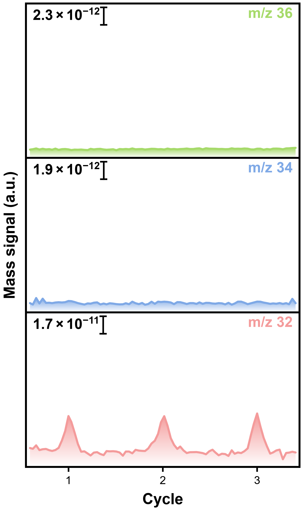

# DEMS 数据处理

把 HAL RC RGA 201 导出的 DEMS 原始 CSV，变成三通道（m/z 36 / 34 / 32）叠层 Cycle 图和
逐文件、逐样品的数据表。命令行一条命令，或者双击两个 `.bat`。

仓库自带三份示例数据（`samples/`）和一份现成输出（`outputs/20261013-dems_0/`），
clone 下来就能跑通、看到成品长什么样。

## 这个工具做什么

一次 DEMS 测试里，质谱仪按固定周期扫 m/z 32 / 34 / 36 三个通道，每个电化学循环对应
一个 m/z 32 的峰。原始导出是一条几千点的长曲线，要把它变成能放进论文或组会的图，
中间有四件重复劳动：

1. 找出每个周期峰在哪（峰很弱、基线还在漂，肉眼数容易错）；
2. 决定取哪几个峰（开头几个峰受启动背景影响，通常取最后 N 个）；
3. 按峰心把横轴换算成 `Cycle` 1…N；
4. 三个通道叠成一张图，并给出每个通道的绝对量级（比例尺）。

这个工具就是把这四步固定成流程，顺带把取段、极值、比例尺、警告一并写成表，
下次换一批数据只要换文件夹。

```text
CSV ──► 自动识别表头/列 ──► 滚动中位数去趋势 ──► 找 m/z 32 周期峰
                                                     │
                                     取末 N 峰 ──► 首末峰前后各留 110 s
                                                     │
                    三通道叠层图 ◄── 比例尺计算 ◄── 线性化 Cycle 轴
                          │
        dems_per_file.csv / dems_best.csv / 数据对比.md / 图/<样品>.png
```

## 主要功能

### 1. 输入：按内容自动识别，不挑文件

没有“跳过前 22 行”这种写死的假设。程序从头扫，**第一列是 `Time` 的那一行**就是表头，
下一行开始读数据；分隔符（`,`、`;`、制表符）、时间写法（`HH:MM:SS`、`H:MM:SS`、
`M:SS`、纯秒数）、通道标注（`Scan 1 : mass 32.00`、`m/z 34`）全部按文件内容判断。
表头没写 m/z 时，按出现顺序当作 32/34/36。

一个文件夹可以混放多个样品，子文件夹递归扫描；只认 `.csv`，`.xlsx`、`.bin`、`.opju`
会被忽略。两个文件推出同一个样品名时（例如 `ru.csv` 和 `ru-File244.csv` 放一起），
后一个自动加 `_2`，并在结果表“警告”列写明，不会互相覆盖图。

细节见 [输入格式](#输入格式最重要)。

### 2. 选峰：按 m/z 32 找周期峰，取最后 N 个

先对 m/z 32 做滚动中位数去趋势（默认 360 s，按实际采样间隔折成点数；9 s 采样的数据约 41 点），
把缓慢的基线漂移压掉；
再在残差上找局部极大：幅度要超过 `1.0e-11`，间距至少 `150 s`，靠得太近的两个候选
只留高的那个。默认取**最后 3 个**峰，`config.yaml` 的 `samples.<文件名>.peaks` 可以按样品改。

取末尾而不是开头，是因为采集刚开始时气路、真空和溶解氧还没稳，早期峰的形状和高度
不能和后面几圈比。识别到几个峰、用了几个、峰心在哪，都会写进结果表。

细节见 [选峰规则](#选峰规则)。

### 3. 取段与 Cycle 轴

取段是“首峰前 110 s 到末峰后 110 s”，保证每个峰两侧都有完整的上升沿和回落，
又不把没用的长基线带进图里；超出记录范围时截到端点，并在表里留一条警告说明。

横轴 `Cycle` 不是文件里的列，而是按 m/z 32 峰心线性换算出来的（第 1 个峰 = 1，
最后一个峰 = N），两端同斜率外推，所以横轴刻度落在峰心上，图上峰尖对得齐。

### 4. 出图：三通道叠层 Cycle 图

每个样品一张图，自上而下三层 `m/z 36 / 34 / 32`，**三层零间距紧贴、共用一条横轴**；
只有最底层标 1…N（N = 用到的峰数）和 `Cycle`，上两层只留小刻度。

每层左上角是“数值 + 工字比例尺”：比例尺**长度固定**，只改数字（保留一位小数），
所以读图时用尺子比，别信纵轴绝对刻度。每层右上角是同色系的 m/z 标签，
左右留边对称。曲线是描边 + 颜色向下渐变到白，一直填到该层底边，弱信号也看得清。

默认**三个样品共用同一段比例尺**（`scale_bar.shared: true`）：同通道取各样品里最大的
那一段，所以三张图的 m/z 32 比例尺数值相同、34 相同、36 相同，峰高可以直接横向比。
曲线矮的样品在框内占的高度按比例缩小，峰尖处依然渐变到白。

输出 600 dpi、Arial、白底黑框、无网格、tight bbox；单张 PNG 约 150 KB，
直接贴 Word / PPT 不用再导。

细节见 [画图规则](#画图规则)。



### 5. 出表：逐文件、逐样品、汇总

- `dems_per_file.csv`：一个源文件一行，记起始时刻、记录时长、识别峰数、取用峰数、
  峰心时刻、取段窗口、三个通道的最小/最大/范围、三条比例尺、警告；
- `dems_best.csv`：一个样品一行，只留最终取段和比例尺，附图的相对路径，
  是写进论文表格的那份；
- `数据对比.md`：上面两表的汇总，加上四条判读说明（横轴只是峰序号、
  纵轴不能跨样品比峰高、比例尺为工字固定长度、34/36 临时放大 10 倍的原因）。

表格都带 BOM，Excel 直接打开不乱码。

### 6. 三种运行方式

- **一键**：双击 `一键DEMS.bat`，把数据文件夹拖进窗口回车，结束时打印输出目录；
  也可以直接 `一键DEMS.bat "D:\数据\某次实验"`。
- **命令行**：`python dems_pipeline.py`（默认读 `samples/`），
  `--input-dir` / `--tag` / `--output-dir` / `--skip-plot` 四个参数。
- **只要表**：`--skip-plot`，不装 matplotlib 也能出 CSV 和 MD。

一键入口会自动找 Python：先试 `python`、`py -3`、常见的安装路径，**优先选真正装好了
numpy/matplotlib 的那个**；`安装依赖.bat` 全局 `pip install` 失败时会退回装到
本目录 `py_deps/`，运行时自动把这个目录加进 `PYTHONPATH`，不污染系统环境。

### 7. 配置驱动

所有会改的东西都在 `config.yaml`，脚本里不写死：画布尺寸、dpi、字体、留白、
三层顺序与颜色、纵轴放大倍数、工字比例尺长度与小数位、取峰数、取段留白、
去趋势窗口、峰间距与幅度阈值、轴标题、输出目录名，以及按文件名覆盖样品名和取峰数。

最常见的一个开关是 `channels[].zoom`：34/36 默认 `10`（没有 ¹⁸O 标记时，
这两个通道只是背景，放大一个数量级看图更清楚），做标记实验时改回 `1.0`，
比例尺数字会自动跟着变。

## 这个工具不做什么

- **不扣背景、不平滑、不重采样**：图上画的是取段范围内的绝对信号，背景怎么处理由判读者决定；
- **不做定量**：质谱输出是离子电流，不是氧气摩尔数，没有标定就不能算产氧速率或法拉第效率；
- **不要求同步电化学文件**：没有 CV / 电位-时间文件也能出图，代价是横轴只能叫“峰序号”，
  不能当严格的循环数用（见 [已知限制](#已知限制)）。

## 快速开始（Windows）

1. 第一次使用先双击 `安装依赖.bat`，等窗口提示完成（只需一次）。
2. 双击 `一键DEMS.bat`。
3. 把放着 CSV 的文件夹拖进黑色窗口，按回车。
4. 正常结束时窗口会打印输出目录。

`一键DEMS.bat` 也可以直接带路径运行：

```bat
一键DEMS.bat "D:\数据\20261013-dems\samples"
```

命令行用法：

```powershell
python dems_pipeline.py                              # 默认读 ./samples
python dems_pipeline.py --input-dir samples
python dems_pipeline.py --input-dir "D:\数据±117" --count 3
python dems_pipeline.py --input-dir samples --skip-plot
python dems_pipeline.py --input-dir samples --window-ms 4750000:5600000  # 只取这段
```

- `--input-dir`：原始 CSV 所在目录，默认本目录下的 `samples/`（没有则退回 `dems/`）。
- `--tag`：覆盖输出目录名前缀；默认就是输入文件夹名。输出到
  `outputs/<名字>_0/`，同名已存在就往后顺延 `_1`、`_2`…（编号从 0 开始）。
- `--output-dir`：直接指定输出目录。
- `--skip-plot`：只出表，不出图。
- `--window T0:T1`：只取这段时间出图（秒），如 `--window 4750:5600`；
  给了就不用“取最后 N 个峰”的规则。
- `--window-ms T0:T1`：同上，单位毫秒（Origin 时间轴），如 `--window-ms 4750000:5600000`。
- `--count N`：取几个峰，覆盖 `peaks.count`，如 `--count 3`。

## 输入格式（最重要）

程序按文件内容自动识别格式，一个样品一个 CSV，不依赖固定的表头行数：

- **表头**：文件里第一段“第一列是 `Time`”的行当表头，下一行开始是数据。
- **分隔符**：`,`、`;`、制表符都能认。
- **时间列**：`HH:MM:SS`、`H:MM:SS`、`M:SS` 或直接写秒数都行。
- **信号列**：表头里写了 `Scan 1 : mass 32.00`、`m/z 34` 这类就按写的取；
  没写就按出现顺序当作 m/z 32、34、36。
- **通道**：至少要包含 `config.yaml` 里那三个 m/z（默认 32/34/36），缺哪个会直接说。
- 只扫 `.csv`；`.xlsx`、`.bin`、`.opju` 不是 CSV，会被忽略。
- 子文件夹会被递归扫描，一个文件夹可以放多个样品。

所以仪器原始导出和舍入后的再导出都能直接读：

```text
# 仪器原始导出（前面一堆仪器表头，之后是数据表头）
"Date",2026/10/13,"Time",16:04:57
"Scan 1","RGA","SEM","mass",32.00,32.00,...
"Time","ms","Scan 1 : mass 32.00","Scan 2 : mass 34.00","Scan 3 : mass 36.00",
00:00:04,      4840,  5.7245e-10,  4.2933e-12,  7.0310e-13,

# 舍入后的再导出（只有数据表头和数据）
Time,ms,Scan 1 : mass 32.00,Scan 2 : mass 34.00,Scan 3 : mass 36.00
0:00:04,4840,5.72E-10,4.29E-12,7.03E-13
```

舍入版只有三位有效数字，34/36 这种弱通道的细节会被抹掉；做定量还是用仪器原始导出。

文件名决定输出图的名字：`ru-File244.csv` → `Ru`（去掉 `-File245` 这类后缀、首字母大写）；
`config.yaml` 的 `samples` 可以按文件名覆盖名字和取峰数。两个文件推出同一个名字时
（比如 `ru.csv` 和 `ru-File244.csv` 放在一起），后一个自动加 `_2`，并在结果表里给警告。

一个能直接跑的输入文件夹：

```text
samples/
├── ru-File244.csv        RuO₂
├── 3%-File245.csv        3% Ce–RuO₂
└── 4.5%-File247.csv      4.5% Ce–RuO₂
```

## 指定取段时间

默认规则是“取最后 N 个峰”。仪器出问题、某几圈不成形、或者想跟 Origin 里手挑的区间对齐时，
直接给时间段就行：

```powershell
python dems_pipeline.py --input-dir D:\数据 --window-ms 4750000:5600000
python dems_pipeline.py --input-dir D:\数据 --window 4750:5600
```

也可以写进 `config.yaml`，按文件给（单位秒）：

```yaml
samples:
  "3%_File295.csv":
    window: [4750, 5600]
```

给了区间之后：完全按它取段，不再加首末峰 ±110 s 的留白；区间内识别到几个峰，
`Cycle` 就从 1 编到几；区间里一个峰都没有会报错，并提示调低 `peaks.min_prominence`。

## 常见报错

| 提示 | 原因 | 处理 |
|---|---|---|
| `没有可用的 CSV` | 目录里没有能认的 CSV | 对照上面的表头示例检查文件 |
| `找不到数据表（没有以 Time 开头的表头行）` | 表头第一列不是 `Time` | 检查表头列名 |
| `文件里只有 m/z 32，缺少 m/z 34、36` | 通道不全 | 用多通道导出，或改 `config.yaml` 的 `channels` |
| `没有识别到 m/z 32 周期峰` | 记录太短、峰太弱或基线漂移大 | 调 `config.yaml` 的 `peaks.min_prominence`、`peaks.min_gap_seconds` |
| `缺少绘图依赖（matplotlib）` | 没装依赖 | 双击 `安装依赖.bat` |
| `写入失败，文件可能正被占用` | 输出图正被别的程序打开 | 关掉那个程序再跑 |

## 输出

```text
outputs/<输入文件夹名>_0/
├── dems_per_file.csv   每个文件一行：起始时刻、时长、峰数、取段、各通道极值、比例尺
├── dems_best.csv       每个样品最终取段与比例尺，含图文件名
├── 数据对比.md          汇总表 + 判读说明
├── Ru.png              三通道 Cycle 图，直接放在这一层
├── 3%.png
└── 4.5%.png
```

目录名固定是「输入文件夹名_编号」：编号从 0 开始，`_0` 已存在就自动用 `_1`，
再跑就 `_2`，不会覆盖上一次的结果。图不再单独放子目录，直接和表放在一起。

`dems_per_file.csv` 一文件一行、`dems_best.csv` 一样品一行、`数据对比.md` 汇总、
`<样品>.png` 每样品一张——上面就是这个工具的输出标准。仓库里的
`outputs/samples_0/` 是 `samples/` 这三份数据按同一标准出的现成输出；
其余 `outputs/*` 是跑出来的结果，`.gitignore` 里只放行 `samples_0/`。

## 画图规则

- 每个样品一张图；自上而下三层独立框、零间距紧贴；三格共用一条横轴，
  只有最底层标 1…N（N = 用到的峰数）和 `Cycle`，上两层只留小刻度。
- 每层左上角：数值 + 紧跟的“工”字比例尺。**比例尺长度固定**，
  只改数字；数字保留一位小数。
- 每层右上角：彩色 `m/z 36/34/32` 标签，距右边框与左边数值距左边框一致。
- 曲线为描边 + 由曲线颜色向下渐变到白，一直填到该层底边。
- 纵轴没有绝对刻度：数据最低点约在框高 5%；共用比例尺时，最高点按该样品范围占总段
  的比例落在 5%–55% 之间（范围最大的样品才到 55%）。
- 600 dpi、Arial、白底、黑框、无网格、tight bbox。

## 选峰规则

1. 对 m/z 32 做滚动中位数去趋势（`peaks.detrend_seconds: 360`，按采样间隔折成点数；
   9 s 采样时是 41 点，14 s 采样时是 27 点）。
2. 局部极大值高于基线 `1.0e-11`、峰间距至少 `150 s` 才算一个周期峰。
3. 默认取**最后 3 个**峰（`--count` 可临时改）；`config.yaml` 的 `samples.<文件名>.peaks`
   可以按样品固定。
4. `peaks.require_regular: true` 时优先取“末尾一段间距规整”的峰：在识别到的峰里找连续
   N 个、间距 max/min ≤ `gap_tolerance`（默认 1.3）的窗口，取最靠后的一段；末尾本来就不规整
   时会在结果表里写明跳过了几个峰。
5. 取段：首峰前、末峰后各留 `110 s`，超出记录范围时截到端点并给警告。
6. 横轴 `Cycle` 是 m/z 32 峰的序号，按峰心线性换算，两端同斜率外推。
7. 识别到的峰间距明显不均（最大/最小 > 1.5）时，结果表会给一条警告：
   这批数据可能不是等周期循环（比如恒电位下的缓慢累积），取段要人工确认。
8. 想跳过这套自动取段，直接用 `--window` / `--window-ms` 或
   `samples.<文件名>.window` 指定区间（见 [指定取段时间](#指定取段时间)）。

## 配置（config.yaml）

| 字段 | 含义 |
|---|---|
| `figure` | 尺寸、dpi、字体、留白 |
| `layout` | 边距、层间距、数据在框内的上下位置、左右留边 |
| `channels` | 三层顺序、m/z、标签、颜色、纵轴放大倍数 `zoom` |
| `scale_bar` | 工字比例尺长度、数字大小与位置、小数位 |
| `peaks` | 取峰数、取段留白、去趋势窗口、峰间距与幅度阈值 |
| `text` | 轴标题 |
| `samples` | 按源文件名指定输出名与取峰数 |

**34/36 的 `zoom` 当前是 10**：本次实验没有做 ¹⁸O 标记，34/36 只是背景，
放大一个数量级避免噪声被拉得很夸张。以后做标记实验时把 `zoom` 改回 `1.0`，
比例尺数字会自动跟着变。

## 命名

- 输出图：`<样品>.png`，直接放在输出目录里；样品名默认由源文件名推导：去掉
  `-File245` 这类后缀、首字母大写（`ru-File244.csv` → `Ru.png`）。
- 输出目录：`outputs/<输入文件夹名>_<编号>/`，编号从 0 开始、已存在就顺延；
  `--output-dir` 可以指定完整路径，`--tag` 只改前缀。

## 环境

需要 Python 3 与 `numpy`、`matplotlib`、`PyYAML`。首次双击 `安装依赖.bat`；
如果全局安装失败，脚本会自动装到本目录的 `py_deps/`，运行时自动加入路径
（`py_deps/`、`output/`、`__pycache__/` 都已在 `.gitignore` 里）。

一键版找不到可用 Python 时，装一个 python.org 的 Python 3（安装时勾选
*Add python.exe to PATH*）再双击 `安装依赖.bat`。Windows 自带的应用商店
`python` 是个占位程序，不算已安装。

## 已知限制

- 本次 DEMS 没有同步的 CV / 电位-时间文件，横轴只是峰序号，
  不能当严格的电化学循环数用。
- 每个样品的纵轴按自身范围铺排，比例尺数值各不相同，
  不同样品之间不能直接按峰高比较。
- 34/36 的 `zoom=10` 是临时设置，换到标记实验要改回 1.0。

## 文件说明

| 文件 | 作用 |
|---|---|
| `dems_analysis.py` | 解析 CSV、找周期峰、取段、写 CSV/MD |
| `dems_plot.py` | 画三通道 Cycle 图 |
| `dems_pipeline.py` | 一键流程：分析 → 出表 → 出图 |
| `config.yaml` | 全部绘图与选峰规则 |
| `一键DEMS.bat` / `tools/run-dems.ps1` | 双击入口 |
| `安装依赖.bat` / `install-deps.ps1` / `requirements.txt` | 依赖安装 |
| `samples/` | 示例数据：三份 HAL 原始导出 |
| `outputs/` | 按上面的输出标准存的一份现成输出（表、图、数据对比） |
| `docs/` | 数据判读报告与文献核查（纯文字结论，不是代码） |
